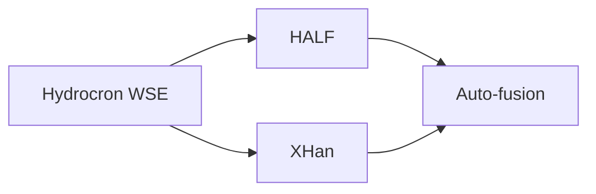

# XHan_Filter_and_Autofusion

## 1 Overview

This guide explains how to *run* the released code. The methods and their parameters are described in the main paper and are not repeated here.

The release contains two independent tools:

- **XHan Filter** ([Section 2](#2-xhan-filter)) filters the SWOT LakeSP water surface elevation (WSE) time series of one or more lakes and labels every observation as retained (1) or removed (0). It is a complete tool on its own; its output can be used directly.
- **Auto-fusion algorithm** ([Section 3](#3-auto-fusion-algorithm)) is designed for users who already have the same lake time series filtered by several filters. It selects, segment by segment, the best filter result and fuses them into one keep/remove mask. It does not modify WSE values.

Running Auto-fusion algorithm is optional. It is only needed when results from more than one filter are available; in v1 these are XHan Filter and HALF.



> [!NOTE]
> **Scope of application.** The current XHan Filter and Auto-fusion algorithm were developed for reservoirs in Central Asia. Applying them to other regions or to natural lakes may require parameter adjustment. Further details on the algorithmic framework and adjustment procedures are provided in the paper.

### Requirements

Python 3.9 or newer. Install the dependencies with

```bash
pip install numpy pandas requests matplotlib
```

For each tool, keep its main script and its module files in **the same folder**. Only the main script (`*_run.py`) is edited and executed.

## 2 XHan Filter

### 2.1 Code structure

```text
XHanFilterLakeSP_v2_run.py                  main script (edit & run)
 |-- XHanFilter_v2_hydrocron.py              Hydrocron / CSV reading
 |-- XHanFilter_v2_attribute_filters.py      72 h selection, flag rules
 |-- XHanFilter_v2_statistical_filters.py    post-filter, outputs
```

An example output for two lakes is provided in `XHan_output_demo/`.

### 2.2 Input

XHan Filter accepts SWOT LakeSP data in one of three forms, selected by `RUN_CONFIG["input_mode"]`:

| Mode | What is read |
|---|---|
| `"hydrocron"` | Data downloaded automatically from the NASA Hydrocron service for the PLD lake IDs in `lake_ids` (internet access required). |
| `"folder"` | Every `*.csv` file in `csv_folder`. |
| `"file"` | The single CSV file `csv_filepath`. |

Local CSV files must use the Hydrocron LakeSP column names. The required columns are `lake_id`, `time_str`, `wse`, the quality fields (`wse_u`, `layovr_val`, `wse_std`, `wse_r_u`) and every column used in an attribute rule (e.g. `overlap`).

> [!IMPORTANT]
> The first column of a local CSV must be `lake_id`. A file may contain several lakes; it is split by `lake_id` and each lake is filtered independently.

### 2.3 What to edit

Open `XHanFilterLakeSP_v2_run.py` and edit the `RUN_CONFIG` dictionary. Only the entries for the chosen input mode are used.

```python
RUN_CONFIG = {
    "input_mode": "hydrocron",           # "hydrocron" | "folder" | "file"

    # --- "hydrocron" mode ---
    "lake_ids": [4620019453, 4620033793],  # PLD lake IDs
    # "SWOT_L2_HR_LakeSP_D" (v. D) or "SWOT_L2_HR_LakeSP_2.0" (v. C)
    "collection_shortname": "SWOT_L2_HR_LakeSP_D",
    "start_time": "2023-07-21T05:33:45Z",  # UTC
    "end_time":   "2026-02-10T21:36:19Z",

    # --- "folder" / "file" mode ---
    "csv_folder":   r"path\to\your\csv_folder",
    "csv_filepath": r"path\to\your\lake.csv",

    "work_dir": r"path\to\output_folder",  # created if missing
    "script_version": "v2",                # label in output file names
    "write_lake_report": "yes",            # "yes" | "no"
}
```

**Attribute rules (optional).** The flag-based rules in `FILTER_CONFIG["attribute_rules"]` can be adapted to your lakes. Each rule is a string on any numeric LakeSP column, written as `"field<b"`, `"field>=a"`, `"a<=field<=b"`, etc. Observations outside the range are removed; missing values are kept.

```python
"attribute_rules": [
    # "0<=area_total<=2",  # bounds x max(median(area_total), p_ref_area)
    "wse_std<1.5",
    "overlap>=10",          # exactly one overlap value must satisfy the rule
],
```

All other entries of `FILTER_CONFIG` are the default values used in the paper and do not need to be changed.

### 2.4 Run

```bash
python XHanFilterLakeSP_v2_run.py
```

The script prints one block per lake and, for more than one lake, a batch summary table.

### 2.5 Output

All files are written to `work_dir`. `<stem>` is `lakeID_<lake_id>_LakeSP_<vC|vD>` in Hydrocron mode and the name of the input CSV in folder/file mode; `<label>` is `vC`, `vD` or `local`.

| File | Content |
|---|---|
| `<stem>_XHanFilter_v2.csv` | One per lake: all original columns plus a last column `filter_flag` (1 = retained, 0 = removed). |
| `<stem>_XHanFilter_v2_Report.txt` | One per lake: parameters used, counts per step, and the reason for every removed row. |
| `df_LakeSP_XHanFilter_v2_LakeSP_<label>.csv` | All lakes in one table (same columns as the per-lake CSV). |
| `batch_summary_XHanFilter_v2_LakeSP_<label>.csv` | One row per lake with the number of raw, removed and retained observations. |

The filtered series is given by the rows with `filter_flag == 1`.

## 3 Auto-fusion algorithm

### 3.1 Code structure

```text
AutoFusion_v1_run.py             main script (edit & run)
 |-- AutoFusion_v1_io.py         input reading, tables, figure
 |-- AutoFusion_v1_fusion.py     fusion core
```

An example output for two lakes is provided in `AutoFusion_output_demo/`.

### 3.2 Input

AutoFusion takes the results of two filters for the same lakes. In v1 these are:

- an **XHan Filter** result: the XHan Filter `work_dir` folder, or its combined `df_LakeSP_XHanFilter_*.csv`;
- a **HALF** result: the combined `df_Hydrocron_HALF_*.csv`, or a folder of per-lake CSVs, produced with the HALF code (<https://doi.org/10.5281/zenodo.20782248>).

Each input is either one CSV or a folder of CSVs, and must contain the columns `lake_id`, `time_str`, `wse` and `filter_flag` (1 = kept, 0 = removed); `wse_u` and `lake_name` are used when present. The standard outputs of both filters already have this format.

> [!NOTE]
> Both filters must be run on the same LakeSP collection (Version C or D) and time window, so that observations can be matched by `time_str`. Only lakes present in both inputs are processed.

### 3.3 What to edit

Open `AutoFusion_v1_run.py` and edit `RUN_CONFIG`:

```python
RUN_CONFIG = {
    # each result: a combined CSV or a folder of per-lake CSVs
    "half_results": r"path\to\df_Hydrocron_HALF_v1_LakeSP_vD.csv",
    "xhan_results": r"path\to\XHan_output_folder",
    "lake_ids": [],              # [] = all lakes found in both inputs
    "work_dir": r"path\to\output_folder",
    "script_version": "v1",
    "plot_score_panel": "yes",   # add the local-cost panel to the figure
    "figure_dpi": 220,
}
```

`FUSION_CONFIG` holds the default parameters used in the paper and does not need to be changed.

### 3.4 Run

```bash
python AutoFusion_v1_run.py
```

### 3.5 Output

Two sub-folders are created in `work_dir`; `<lake>` is `<lake_id>_<lake_name>`.

| File | Content |
|---|---|
| `FusedWSE_ts_dignoise/<lake>_AutoFusion_v1.csv` | One row per observation (columns listed below). |
| `figures/<lake>_AutoFusion_v1.png` | The two filter results and the fused series in separate panels; the fused panel is coloured by the filter each segment comes from. |

Columns of the fused CSV:

| Column | Content |
|---|---|
| `lake_id`, `time_str`, `Time` | Lake and observation time |
| `wse`, `wse_u` | Original WSE and its uncertainty (never modified) |
| `half_flag`, `xhan_flag` | Keep flag of each filter (1/0; empty if the observation is absent from that result) |
| `fused_flag` | **Final keep flag** (1 = retained, 0 = removed) |
| `selected_method`, `segment_id` | Filter selected for this observation and its segment number |
| `half_score`, `xhan_score`, `judge_zscore`, `judge_confidence` | Diagnostic scores (see paper) |

The fused series is given by the rows with `fused_flag == 1`.
